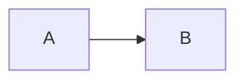

# Feature reference

Everything holo-convert has to carry through, in one document: inline marks,
lists, tables, code, maths, images, links, breaks - and the characters the
pre-passes rewrite: arrows ->, dashes - and ticks , and a wikilink to
a label or Plain target.

## Text

Plain, *emphasis*, **strong**, ***both***, ~~strike~~, `inline code`, ^super^,
~sub~, a footnote[^1], an [external link](https://example.org), and an
[internal link](#tables). A [broken anchor](#nowhere-at-all) and a near miss
to [the tables](#tabels).

> A block quote, with **strong** text inside.

- [ ] an open task
- [x] a done task

1. first
2. second
   - nested bullet
   - another

**A label, then a list with no blank line between:**
- first, as GitHub renders it
- second
  - nested

Term
: Its definition.


## Tables

| Left | Centre | Right |
|:-----|:------:|------:|
| a<br>b | `x` | 1.5 |
| a very long cell that has to wrap across the column width when rendered | mid | 2 |

| Identifier | Meaning |
| --- | --- |
| `converter-services-2026-10-10` | a long identifier in the first column |
| `x` | short |


## Code

```python
def f(x):
    # arrows → and dashes — and ticks ✓ stay as they are in code
    return x ** 2  # “quotes”, ≈
```



## Maths

Inline $e^{i\pi} + 1 = 0$ and display:

$$\sum_{k=1}^{n} k = \frac{n(n+1)}{2}$$

## Images


Line one\
line two, after a hard break.

\newpage

## After a page break

The end.

[^1]: The footnote, with `code`.
